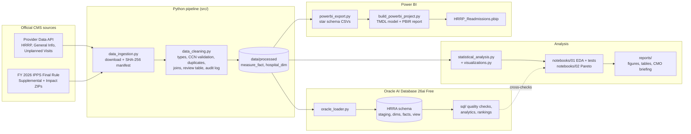

# Hospital Readmission Driver Analysis (CMS HRRP, FY 2026)

An end-to-end healthcare analytics project on official CMS data. It covers a Python ingestion and validation
pipeline, statistical testing, Pareto prioritisation, an Oracle SQL analytics layer, a Power BI dashboard generated
from code, and a briefing for a Chief Medical Officer.

**Question:** which available hospital characteristics, clinical measures and geographic factors are *associated
with* higher 30-day excess readmissions and HRRP payment reductions, and where should care-transition
improvement efforts start?


> **Scope.** The data is aggregated at hospital level. Findings describe associations between hospitals, not
> patient-level causes. The source files contain no cost data, so nothing here is stated in dollars.

---

## Contents
1. [Business problem](#1-business-problem)
2. [Data sources](#2-data-sources)
3. [Architecture](#3-architecture)
4. [Project structure](#4-project-structure)
5. [Setup and execution](#5-setup-and-execution)
6. [Data cleaning decisions](#6-data-cleaning-decisions)
7. [Statistical methods](#7-statistical-methods)
8. [Oracle SQL](#8-oracle-sql)
9. [Power BI dashboard](#9-power-bi-dashboard)
10. [Verified findings](#10-verified-findings)
11. [Testing and reproducibility](#11-testing-and-reproducibility)
12. [Limitations and future work](#12-limitations-and-future-work)

---

## 1. Business problem

Under the Hospital Readmissions Reduction Program (HRRP), CMS reduces Medicare payments to acute-care hospitals with
more 30-day readmissions than expected for six conditions: heart attack (AMI), heart failure (HF), pneumonia, COPD,
coronary artery bypass graft (CABG) surgery, and elective hip/knee replacement.

This project aims to help hospital leadership:
- identify clinical measures and hospital groups that warrant investigation;
- understand variation in readmission performance and its link to payment reductions;
- prioritise care-transition improvement initiatives for evaluation.

The briefing for leadership is in **[reports/cmo_report.md](reports/cmo_report.md)**.

## 2. Data sources

All data is official and public. Download URLs were verified on 2026-10-20, and every file is recorded with a
SHA-256 checksum in `data/raw/manifest.json`. Full field-level documentation: **[docs/data_sources.md](docs/data_sources.md)**.

| Dataset | Publisher / ID | Period | Used for |
|---|---|---|---|
| [Hospital Readmissions Reduction Program](https://data.cms.gov/provider-data/dataset/9n3s-kdb3) | CMS Provider Data `9n3s-kdb3` | Jul 2021 – Jun 2024 | ERR, predicted/expected rates, discharges, readmissions (18,330 hospital × measure rows) |
| [FY 2026 HRRP Supplemental File](https://www.cms.gov/medicare/payment/prospective-payment-systems/acute-inpatient-pps/fy-2026-ipps-final-rule-home-page) | CMS IPPS Final Rule | Jul 2021 – Jun 2024 | Official payment adjustment factor, penalty indicator, peer group, dual-eligible proportion, DRG ratios |
| [Hospital General Information](https://data.cms.gov/provider-data/dataset/xubh-q36u) | CMS Provider Data `xubh-q36u` | 2026 snapshot | Hospital type, ownership, star rating |
| [FY 2026 IPPS Impact File](https://www.cms.gov/medicare/payment/prospective-payment-systems/acute-inpatient-pps/fy-2026-ipps-final-rule-home-page) | CMS IPPS Final Rule | FY 2026 | Teaching proxy (resident-to-bed ratio), beds, urban/rural, Census division |
| [Unplanned Hospital Visits – State / National](https://data.cms.gov/provider-data/dataset/4gkm-5ypv) | CMS Provider Data `4gkm-5ypv`, `cvcs-xecj` | Jul 2023 – Jun 2025 | Context only (see §6) |

**Not available in these sources:** actual readmission costs, dollar penalty amounts, patient-level data, more than
one HRRP reporting period, or a yes/no teaching-hospital field.

## 3. Architecture



The Python, Oracle and Power BI layers each compute the key results independently, and the results are compared
(see §11).

## 4. Project structure

```
hospital-readmission-analysis/
├── data/                      # git-ignored; rebuilt by the pipeline
│   ├── raw/                   # CMS downloads + manifest.json (checksums)
│   ├── processed/             # cleaned tables, review records, cleaning log
│   └── powerbi/               # dashboard CSVs
├── docs/
│   ├── data_sources.md        # datasets, fields, availability matrix, join keys
│   ├── data_cleaning_decisions.md
│   └── oracle_setup.md        # install, credentials, SQL Developer, validation checklist
├── notebooks/
│   ├── 01_eda_and_statistics.ipynb
│   └── 02_pareto_analysis.ipynb
├── src/
│   ├── data_ingestion.py      # official downloads, loaders, schema report
│   ├── data_cleaning.py       # validation, cleaning, joins, guarded imputation
│   ├── statistical_analysis.py
│   ├── visualizations.py
│   ├── oracle_loader.py       # load + run SQL scripts (credentials via keyring)
│   └── powerbi_export.py
├── sql/
│   ├── create_tables.sql
│   ├── data_quality_checks.sql
│   ├── readmission_analysis.sql
│   └── hospital_rankings.sql
├── dashboard/                 # Power BI Project (PBIP) + README + screenshots
├── reports/
│   ├── cmo_report.md          # stakeholder briefing
│   ├── figures/               # 13 charts
│   ├── tables/                # test results, summaries (CSV)
│   └── sql_results/           # Oracle query outputs (CSV)
├── scripts/
│   ├── install_oracle_free.ps1
│   └── build_powerbi_project.py
├── tests/                     # 51 pytest tests
├── requirements.txt
└── .gitignore
```

## 5. Setup and execution

**Requirements:** Windows 10/11, Python (developed and tested on 3.14.2; other versions untested), Git. Optional:
Oracle Database Free and Power BI Desktop.

```powershell
git clone <your-repo-url> hospital-readmission-analysis
cd hospital-readmission-analysis
python -m venv .venv
.venv\Scripts\python -m pip install -r requirements.txt

# 1. Data pipeline
.venv\Scripts\python -m src.data_ingestion        # download official files -> data/raw (add --force to refresh)
.venv\Scripts\python -m src.data_cleaning         # validate + build data/processed

# 2. Analysis notebooks (or open them in VS Code / Jupyter)
.venv\Scripts\jupyter nbconvert --to notebook --execute --inplace notebooks\01_eda_and_statistics.ipynb
.venv\Scripts\jupyter nbconvert --to notebook --execute --inplace notebooks\02_pareto_analysis.ipynb

# 3. Oracle (optional; see docs/oracle_setup.md)
.venv\Scripts\python -m src.oracle_loader --all   # create tables, load, run all SQL, export results

# 4. Power BI (optional; see dashboard/README.md)
.venv\Scripts\python -m src.powerbi_export
.venv\Scripts\python scripts\build_powerbi_project.py
start dashboard\HRRP_Readmissions.pbip

# 5. Tests
.venv\Scripts\python -m pytest -q
```

> CMS replaces files when it refreshes data. `data_ingestion.py` keeps existing files unless you pass `--force`, so
> results stay tied to the checksummed files in the manifest. Re-downloading may produce slightly different numbers.

## 6. Data cleaning decisions

Details and stage-by-stage row counts: **[docs/data_cleaning_decisions.md](docs/data_cleaning_decisions.md)**.

| Issue | Decision |
|---|---|
| CCNs with leading zeros (`010001`) | Read every identifier as text; validate against `^\d{2}[0-9A-Z]\d{3}$`. VA/DoD CCNs end in a letter (`01014F`) and are valid. Nothing is padded or guessed. |
| Missing or invalid IDs, duplicates | Moved to a review table with a reason code (0 found in this release) |
| ERR not published (6,610 rows; CMS footnotes 1, 5, 7) | `RECORD_STATUS = EXCLUDED_NO_ERR`; **not imputed** |
| `Too Few to Report` readmissions (3,683 rows) | Kept as missing with a `READMISSIONS_SUPPRESSED` flag (suppressed, not zero) |
| Thousands separators (`"1,218"`) in the Supplemental File | Removed before numeric conversion. The Oracle penalty-rule check found that 193 values had become missing (fixed in `fb98d10`). |
| Cross-file consistency | ERR matches between the two CMS publications for 11,523 / 11,523 pairs. Reduction % = (1 − factor) × 100 for all hospitals. |
| Joins | Left joins from HRRP hospitals: 99.4% match General Info, 98.7% Impact File, 96.1% Supplemental (gap is mainly Maryland, which is exempt) |

**State-level imputation was considered and rejected.** The state dataset has no readmission rate to impute, and the
national rates cover a different period (2023–25) and a different metric (raw rate vs. risk-standardised ratio).
`impute_from_reference()` is kept and unit-tested for valid future use. It only fills a value when measure and period
match exactly, and records `IMPUTED_FLAG`, the method and the source value.

## 7. Statistical methods

Full workings, assumption checks and interpretation: [notebooks/01_eda_and_statistics.ipynb](notebooks/01_eda_and_statistics.ipynb).

- **Unit of analysis:** each test runs within one clinical measure, so a hospital contributes at most one value.
- **Two groups:** Welch's t-test as the primary test, because ERR is near-symmetric (skew 0.1–0.5), n is large, and
  Levene tests show unequal variances. Mann–Whitney U is the robustness check. Effect sizes are Hedges' *g* and
  rank-biserial *r*, with 95% CIs.
- **Several groups:** Welch's ANOVA, with Kruskal–Wallis and ε² as the check. Post-hoc comparisons are pairwise
  Welch tests.
- **Proportions:** chi-square test of independence (all expected counts ≥ 90), Cramér's V and Wilson CIs.
- **Multiple comparisons:** Holm correction across the six measures in each family.
- **Sensitivity:** tests repeated on hospitals with ≥ 100 eligible discharges, because CMS shrinks small-hospital
  ERRs toward 1.
- **Confounding:** OLS of hospital mean ERR on all characteristics together, with standard errors clustered by state.
- **Correlation:** Spearman ρ with pairwise-complete n reported. Fields that are partly redundant with each other are
  flagged (payment reduction is computed from ERR; star rating includes readmissions).
- **Pareto:** three labelled substitute metrics, since cost data is unavailable:
  1. payment-reduction points, from the CMS formula `NM × DRG ratio × (ERR − peer median)` applied per measure. This
     reproduces the official reduction for all 2,937 hospitals to within 0.0063 percentage points.
  2. estimated excess readmissions, `readmissions × (1 − 1/ERR)`, as a derived estimate.
  3. penalty-flag counts.

## 8. Oracle SQL

Tested on **Oracle AI Database 26ai Free (23.26.3)**; the syntax targets Oracle 19c and later. Full guide:
**[docs/oracle_setup.md](docs/oracle_setup.md)**.

| Script | Contents |
|---|---|
| `create_tables.sql` | Staging table (raw text), `DIM_HOSPITAL`, `DIM_MEASURE`, `FACT_HOSPITAL_PAYMENT`, `FACT_READMISSION_MEASURE`. PK/FK/CHECK constraints, indexes, analysis view. |
| `data_quality_checks.sql` | Missing values, CCN format, duplicate keys, `VALIDATE_CONVERSION`, staging-to-fact reconciliation, ERR = predicted ÷ expected, CMS penalty rule, factor/percentage consistency |
| `readmission_analysis.sql` | CTE summaries by measure, state and hospital characteristic; peer groups; payment reconstruction; Pareto (`RATIO_TO_REPORT`, running `SUM`); `NTILE` tiers |
| `hospital_rankings.sql` | `RANK` / `DENSE_RANK` / `PERCENT_RANK` within state × measure; multi-measure flags; rank within peer group |

- **Setup:** `scripts/install_oracle_free.ps1` (run as administrator) installs Oracle silently and creates the
  `HRRA` schema in `FREEPDB1`. The schema password goes into **Windows Credential Manager**. Only `ORACLE_USER` and
  `ORACLE_DSN` are environment variables, and no secret is written to the repository.
- **Run:** `python -m src.oracle_loader --all` loads the data and runs every script, saving results to
  `reports/sql_results/`. In SQL Developer, connect as `HRRA` to `localhost:1521/FREEPDB1` and run each script with
  F5.
- **Last full run:** 43 statements, 0 errors. All `*_violations` checks return no violations.

## 9. Power BI dashboard

A six-page **Power BI Project (`.pbip`)** generated by `scripts/build_powerbi_project.py`. It is text-based TMDL and
PBIR, so Git can diff it. Guide: **[dashboard/README.md](dashboard/README.md)**.

| Page | Highlights |
|---|---|
| Overview | KPI cards; payment-reduction points and estimated excess readmissions by measure |
| State Comparison | Mean reduction by state; state summary table |
| Hospital Rankings | Hospitals ranked by reduction within state, with measures flagged and mean ERR |
| Clinical Conditions | % ERR > 1, penalty flag rate, excess-readmission share; Census division × measure matrix |
| Payment Reduction | Pareto share and cumulative share (80% line); reduction by measures flagged and by peer group |
| Definitions & Limitations | Metric definitions, sources, caveats |

**Filters:** state, clinical measure, teaching status, urban/rural, ownership and reporting period. The model has
21 documented DAX measures.

**Verification:** I opened and refreshed the report in Power BI Desktop 2.159.883.0, and the rendered values match
the Python and Oracle results (see `dashboard/README.md`). **No `.pbix` is committed.** Use *File > Save as* if you
need one.

| | |
|---|---|
|  |  |

## 10. Verified findings

Each finding below is reproduced by notebook outputs and saved tables. All are **associations**.

| # | Finding | Evidence |
|---|---|---|
| 1 | **Pneumonia and heart failure account for 60% of payment-reduction points** (36% + 24%). Four of six measures are needed to pass 80% (87%), so this is a clear ranking, not a sharp 80/20 split. | Notebook 02 §A; Oracle Pareto query (identical shares) |
| 2 | Heart failure and pneumonia account for **75% of estimated excess readmissions** at above-expected hospitals (derived estimate). | Notebook 02 §B |
| 3 | **34% of hospitals hold 80% of payment-reduction points.** Hospitals flagged on 3+ measures (35% of hospitals) hold 67%. | Notebook 02 §D |
| 4 | Penalty flags cluster within hospitals: P(pneumonia flag \| HF flag) = 60% vs 40% without an HF flag (Cramér's V = 0.20). | Notebook 02 §D |
| 5 | **Teaching status:** no meaningful ERR difference on any measure (Holm-adjusted p > 0.18, \|g\| < 0.1). The same holds in the sensitivity analysis. | Notebook 01 H1 |
| 6 | **Large urban vs rural:** higher ERR for pneumonia (+0.020, 95% CI 0.014–0.027) and AMI (+0.017). Both persist with ≥ 100 discharges. The COPD difference does not. | Notebook 01 H3 |
| 7 | **Dual-eligible share** is associated with higher mean ERR (+0.07 per unit, after adjustment), but **not** with larger payment reductions. This is consistent with CMS peer grouping. | Notebook 01 H5, §7 |
| 8 | **Bed size has the strongest association with being penalised:** 62% of hospitals under 100 beds vs 87–89% of larger ones (V = 0.30). This is plausibly linked to the ≥ 25-discharge eligibility rule (2.5 vs 4.4–5.4 eligible measures). | Notebook 01 H4 |
| 9 | After adjustment, teaching status, ownership and urban/rural are not significant. Observable characteristics explain only **R² = 0.06** of the variation in mean ERR. | Notebook 01 §7 |
| 10 | 78.4% of hospitals with a payment factor receive a reduction. The median is **0.19%** of base operating DRG payments, and 15 hospitals are at the 3% cap. | Notebook 01 §9; Power BI |

**Recommendations for evaluation** (not proven by this data): a heart failure and pneumonia transition bundle
(discharge planning plus follow-up within 7 days), pharmacist-led medication reconciliation for heart failure, and
hospital-wide post-discharge outreach at sites flagged on several measures. See [reports/cmo_report.md](reports/cmo_report.md).

## 11. Testing and reproducibility

`pytest` runs 51 tests across five files:

| File | Covers |
|---|---|
| `test_data_cleaning.py` | Column standardisation, numeric parsing (incl. `"1,218"`), CCN validation, duplicate detection, missing-ID handling, range checks, imputation flags and guards |
| `test_processed_data.py` | Schema and dtypes, unique keys, valid ranges, status rules, CMS penalty-rule consistency, cross-file ERR reconciliation, pinned summary metrics |
| `test_statistical_analysis.py` | Welch CI vs SciPy, effect sizes, Holm correction, Pareto logic, CMS payment formula and cap, Python vs Oracle Pareto |
| `test_sql.py` | Static checks: script parsing, unique labels, no non-Oracle syntax, required analytical features, loader columns match the DDL. Live checks (skipped when Oracle is not running): row counts, every `*_violations` query empty, Oracle vs pandas mean ERR. |
| `test_powerbi.py` | Export totals reconcile; every field referenced by a visual exists in the model; page metadata |

**Cross-implementation checks:** Python, Oracle SQL and Power BI each produce the Pareto shares, penalty rates and
headline KPIs independently, and the results agree.

**Reproducibility check:** after a full rebuild from the checksummed raw files (cleaning → export → both notebooks
re-executed), every committed table, figure and dashboard file was byte-identical. Only notebook execution
timestamps changed.

**Manual validation** for environments without Oracle or Power BI: [docs/oracle_setup.md §5](docs/oracle_setup.md)
and the verification record in [dashboard/README.md](dashboard/README.md).

## 12. Limitations and future work

**Limitations**
- Aggregate, hospital-level, observational data: no patient-level causes and no causal claims. Unmeasured
  confounding (frailty beyond CMS risk adjustment, community resources) remains.
- One performance period (Jul 2021 – Jun 2024), so no trends.
- No cost data. Payment results are percentages; "points" are summed across hospitals of different sizes.
- Teaching status is a proxy (resident-to-bed ratio > 0). Hospital attributes are current snapshots, while outcomes
  are from 2021–2024.
- Estimated excess readmissions exclude suppressed counts, which come mostly from small hospitals.
- CMS shrinks small-hospital ERRs toward 1, which affects size comparisons.
- 118 HRRP hospitals have no payment factor in the Supplemental File. 43 are in Maryland, which is exempt from
  HRRP payment adjustment; the rest are hospitals CMS excluded, e.g. those not open on its October 2025 list.

**Future work**
- Add archived HRRP files (FY 2019–2025) for trend and before/after analysis. The model and dashboard already have
  period fields.
- Add base operating DRG payments (e.g., from cost reports) to convert payment-reduction points into dollar
  estimates.
- Add social-risk data (Area Deprivation Index, post-acute care supply) and model ERR with multilevel models.
- Schedule the pipeline and publish the dashboard to the Power BI service with scheduled refresh.

---

*Data: Centers for Medicare & Medicaid Services (public domain). This is an independent educational project, not
affiliated with or endorsed by CMS.*
