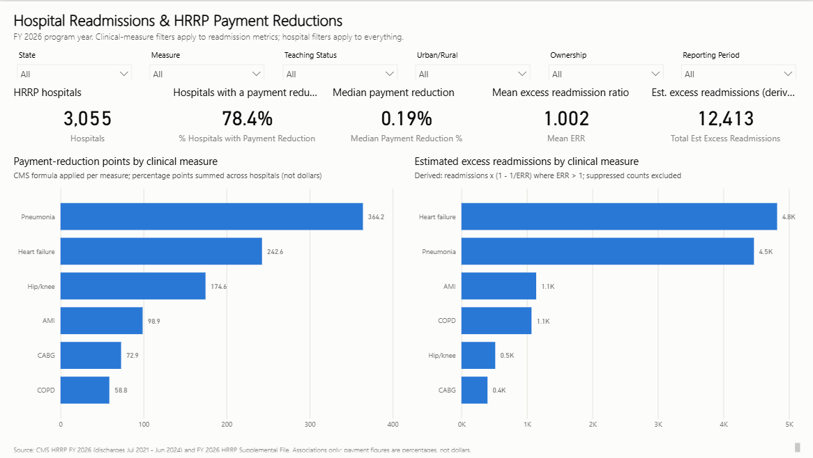
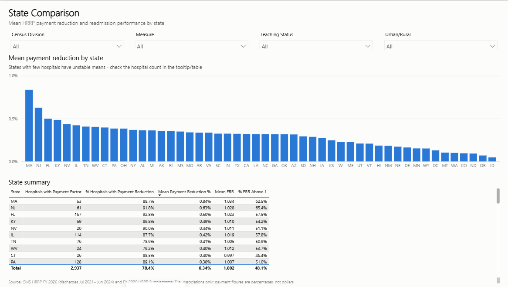
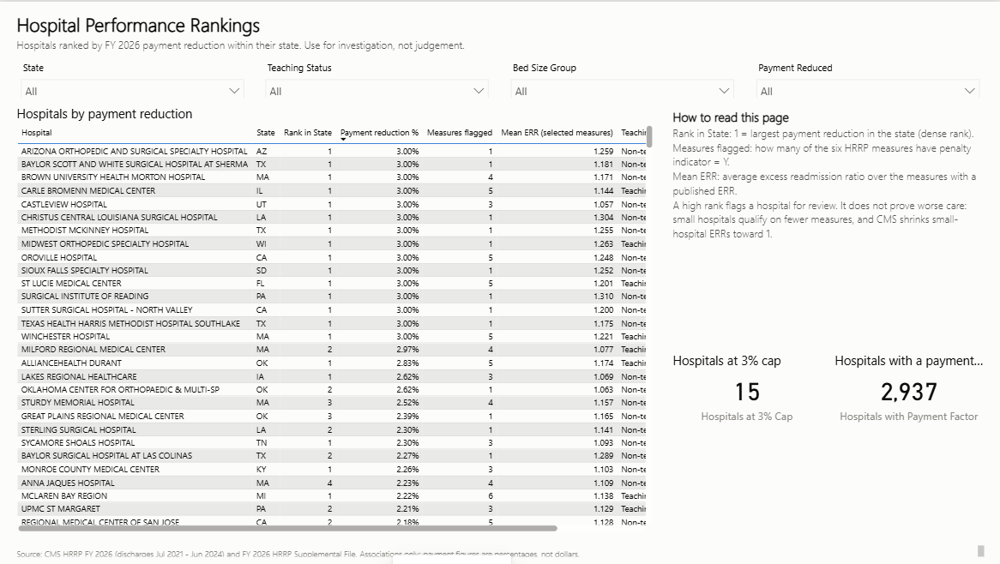
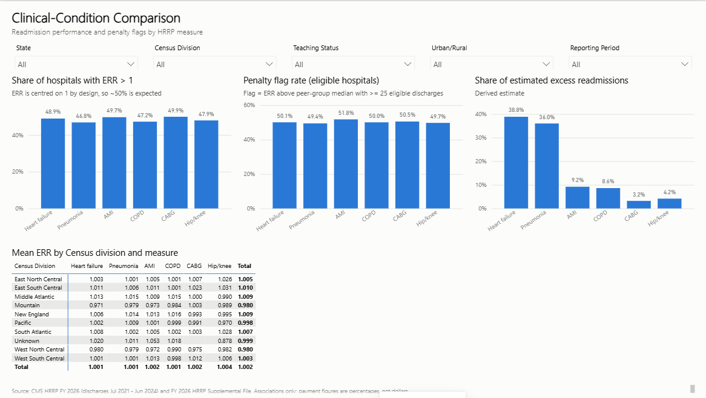
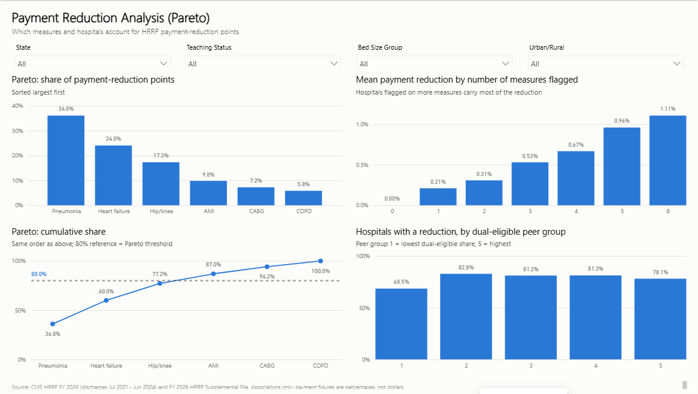

# Power BI Dashboard: HRRP Readmissions

A six-page interactive report built as a **Power BI Project (PBIP)**: plain-text files that Git can diff,
generated from code and opened directly by Power BI Desktop.

| Item | Status |
|---|---|
| Project files | `HRRP_Readmissions.pbip`, `.SemanticModel/` (TMDL), `.Report/` (PBIR) |
| Generated by | `scripts/build_powerbi_project.py` |
| Verified in | Power BI Desktop **2.159.883.0** (Microsoft Store), October 2026 |
| Schema check | 71 JSON files validated against Microsoft's published schemas; 0 errors |
| `.pbix` file | **Not created.** To get one, open the project and use *File > Save as > .pbix* (see below). |



## Open the dashboard

```powershell
.venv\Scripts\python -m src.data_ingestion      # official CMS files -> data/raw
.venv\Scripts\python -m src.data_cleaning       # -> data/processed
.venv\Scripts\python -m src.powerbi_export      # -> data/powerbi (3 CSVs)
.venv\Scripts\python scripts\build_powerbi_project.py   # optional: regenerate the PBIP
```

1. Double-click `dashboard/HRRP_Readmissions.pbip` (Power BI Desktop, free from the Microsoft Store).
2. If the cards show **(Blank)** with "Some of the tables have incomplete or no data", click **Refresh now**.
   A freshly generated model has no cached data yet.
3. **Different folder?** The CSV location is a model parameter. Go to *Home > Transform data > Edit parameters >
   DataFolder*, set it to your `data\powerbi` folder, then *Refresh*. The generator writes the absolute path of
   the machine it ran on.
4. **Want a single file?** Use *File > Save as*, choose *Power BI file (.pbix)*, and save it in `dashboard/`. `.pbix` files
   are git-ignored because they are binary and include the data.

If you edit the report in Desktop and save, the PBIP files change. Re-running the generator **overwrites** those
edits (it keeps only the `.pbi/` cache and `.platform` metadata).

## Data model

Star schema, imported from CSV (`src/powerbi_export.py`):

```
Measure (6) 1 ──< ReadmissionFact (18,330) >── 1 Hospital (3,055)
 Measure Code         Facility ID + Measure Code      Facility ID
```

| Table | Grain | Key columns |
|---|---|---|
| `Hospital` | one HRRP hospital | State, Census Division, Urban/Rural, Teaching Status, Ownership, Bed Size Group, Payment Reduction %, Payment Reduced, Peer Group, Measures Flagged |
| `Measure` | one HRRP clinical measure | Measure (sorted by Measure Sort), Measure Full Name |
| `ReadmissionFact` | hospital × measure × period | ERR, Predicted/Expected Rate, Eligible Discharges, Penalty Indicator, Payment Reduction Points, Est Excess Readmissions, Reporting Period |

Relationships are single-direction (dimension filters fact). So:
- **Hospital filters** (state, teaching status, …) affect every visual.
- **Measure filters** affect readmission metrics, but not hospital-level payment KPIs. Those are hospital-wide by
  definition: one payment factor covers all six measures. The Definitions page says this.

## DAX measures

| Measure | Definition | Format |
|---|---|---|
| Mean ERR / Median ERR | `AVERAGE` / `MEDIAN` of `ReadmissionFact[ERR]` (blank ERRs ignored) | 0.000 |
| % ERR Above 1 | ERR rows > 1 ÷ ERR rows | % |
| Penalty Flags | rows with official `Penalty Indicator = "Y"` | #,0 |
| Penalty Flag Rate | Penalty Flags ÷ rows with ≥25 eligible discharges | % |
| Total Reduction Points | `SUM` of each hospital's official reduction split by measure (CMS formula) | 0.0 |
| Share / Cumulative Share of Reduction Points | Pareto share; cumulative = this measure + all larger ones, evaluated in `ALLSELECTED('Measure')` | % |
| Total Est Excess Readmissions | `SUM` of `readmissions × (1 − 1/ERR)` where ERR > 1 (derived estimate) | #,0 |
| Hospitals / Hospitals with Payment Factor | `COUNTROWS(Hospital)`, optionally filtered to the Supplemental File | #,0 |
| % Hospitals with Payment Reduction | factor < 1.0000 ÷ hospitals with a factor | % |
| Mean / Median Payment Reduction % | of `Hospital[Payment Reduction %]` (0–3) | 0.00"%" |
| Rank in State | `RANKX` (dense) of payment reduction within the hospital's state | 0 |
| Reporting Periods | `DISTINCTCOUNT` of reporting period (currently 1) | 0 |

Every measure has a description, which appears as a tooltip in the Fields pane.

## Pages and visuals

| Page | Visuals | Filters |
|---|---|---|
| **Overview** | 5 KPI cards (hospitals, % with reduction, median reduction, mean ERR, est. excess readmissions); bars of reduction points and est. excess readmissions by measure (tooltips: share, flags, mean ERR) | State, Measure, Teaching Status, Urban/Rural, Ownership, Reporting Period |
| **State Comparison** | Columns of mean payment reduction by state (tooltip: hospital count, % reduced); state summary table | Census Division, Measure, Teaching, Urban/Rural |
| **Hospital Rankings** | Table of hospitals sorted by payment reduction, with rank in state, measures flagged, mean ERR; reading guide; cap and coverage cards | State, Teaching, Bed Size, Payment Reduced |
| **Clinical Conditions** | % ERR > 1, penalty flag rate and share of est. excess readmissions by measure; Census division × measure matrix of mean ERR | State, Census Division, Teaching, Urban/Rural, Reporting Period |
| **Payment Reduction** | Pareto share and cumulative share (two aligned visuals, no dual axis, 80% reference line); mean reduction by number of measures flagged; % reduced by dual-eligible peer group | State, Teaching, Bed Size, Urban/Rural |
| **Definitions & Limitations** | Metric definitions, sources, limitations; reporting-period count | n/a |

**Hospital type:** every HRRP hospital that matches General Information is an *Acute Care Hospital*, so a hospital-type
filter would have a single value. The report uses teaching status, ownership, size and location instead.

**Trends:** the data has one performance period. The Reporting Period filter and the period columns are already in
the model, so adding prior-year HRRP files to the pipeline makes trend visuals possible without changing the model.

## Verification record (Power BI Desktop 2.159.883.0)

Values read from the rendered report were compared with the Python and Oracle outputs:

| Check | Power BI | Python / Oracle |
|---|---|---|
| HRRP hospitals | 3,055 | 3,055 |
| % hospitals with a payment reduction | 78.4% | 78.4% (2,302 / 2,937) |
| Median / mean payment reduction | 0.19% / 0.34% | 0.19% / 0.345% |
| Mean ERR | 1.002 | 1.0018 |
| Est. excess readmissions | 12,413 | 12,413 |
| Reduction points: PN / HF / Hip-knee / AMI / CABG / COPD | 364.2 / 242.6 / 174.6 / 98.9 / 72.9 / 58.8 | identical (notebook 02, Oracle SQL) |
| Pareto cumulative | 36.0 → 60.0 → 77.2 → 87.0 → 94.2 → 100% | identical |
| Penalty flag rate, AMI / HF | 51.8% / 50.1% | 51.8% / 50.1% |
| Hospitals at 3% cap | 15 | 15 |
| Massachusetts mean reduction | 0.84% | 0.837% |

**Issues found and fixed during verification:**
1. The cumulative Pareto measure first showed 100% on every point. `Measure[Measure]` is sorted by
   `Measure Sort`, so visuals also group by that column. `ALLSELECTED('Measure'[Measure])` left the sort column
   filtered, so each row only saw itself. Fixed by evaluating inside `ALLSELECTED('Measure')`.
2. A card abbreviated 12,413 as "12K". Display units were set to none.
3. The ranking table's total row showed a meaningless maximum. Totals were turned off.

Not verified: slicer interactions were not clicked through automatically. They use standard single-direction
relationships, but check them by hand when you first open the report.

## Screenshots

| | |
|---|---|
|  |  |
|  |  |
