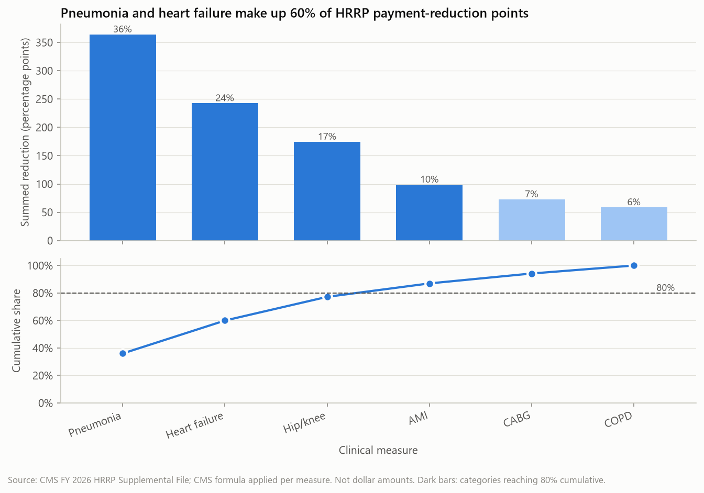
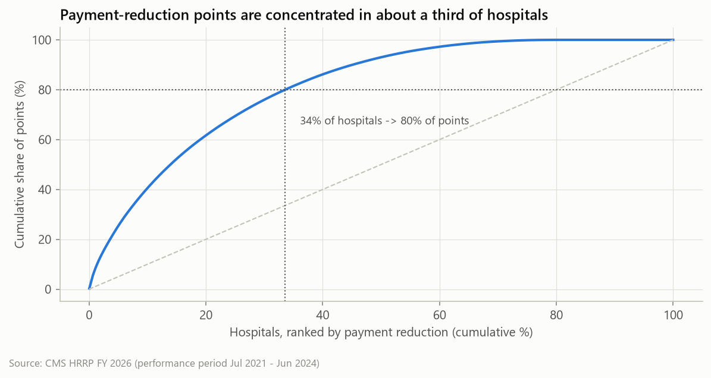

# Readmission Performance and HRRP Payment Reductions: Briefing for the Chief Medical Officer

**Data:** CMS Hospital Readmissions Reduction Program, FY 2026 program year (discharges 1 Jul 2021 – 30 Jun 2024),
3,055 hospitals; official FY 2026 payment adjustment factors for 2,937 of them.
**Prepared:** October 2026. **Status:** analysis of public, aggregate hospital-level data. Findings are associations, not causes.

---

## Summary

1. **Heart failure and pneumonia are the priority conditions.** Together they account for **60% of all HRRP
   payment-reduction points** nationally and an estimated **75% of readmissions above expected** at hospitals
   performing worse than expected.
2. **The burden is concentrated in hospitals more than in conditions.** About **one-third of hospitals carry 80%** of
   payment-reduction points. Hospitals flagged on three or more conditions (35% of hospitals) carry **67%**.
3. **Problems tend to co-occur.** Among hospitals eligible on both, those flagged for heart failure are flagged for
   pneumonia 60% of the time, against 40% for those not flagged for heart failure. This pattern is consistent with
   shared, hospital-wide care-transition factors, though the data cannot confirm them.
4. **Most structural characteristics explain little.** Teaching status, ownership and urban/rural location show no
   independent association with readmission performance once size and patient mix are accounted for. Together,
   all observed characteristics explain about 6% of the variation.
5. **Penalties are common but small.** 78% of hospitals receive a reduction. The median is **0.19%** of base operating DRG
   payments, and only 15 hospitals reach the 3% cap.

**Recommendation:** run an evaluated care-transition programme focused first on heart failure and pneumonia.
Prioritise sites flagged on several conditions (details in Section 5).

---

## 1. What is measured

| Term | Meaning |
|---|---|
| **Excess readmission ratio (ERR)** | A hospital's predicted 30-day readmission rate ÷ the rate expected for an average hospital with the same patients. ERR > 1 = more readmissions than expected. Risk-adjusted by CMS. |
| **Penalty indicator** | CMS flag: ≥25 eligible discharges *and* ERR above the median of the hospital's **peer group** (hospitals with a similar share of dual Medicare/Medicaid patients). |
| **Payment reduction** | Percentage cut to base operating DRG payments for FY 2026 (0–3%), calculated from all flagged conditions. |

The six HRRP conditions are heart attack (AMI), heart failure (HF), pneumonia, COPD, coronary artery bypass graft
(CABG), and elective hip/knee replacement.

## 2. Key verified findings

### 2.1 Which conditions drive payment reductions

Using CMS's published formula, the official reduction was reproduced for all 2,937 hospitals (maximum difference
0.006 percentage points), and each hospital's reduction was then split by condition.

| Condition | Share of payment-reduction points | Share of estimated excess readmissions* |
|---|---|---|
| Pneumonia | **36%** | 36% |
| Heart failure | **24%** | **39%** |
| Hip/knee replacement | 17% | 4% |
| AMI | 10% | 9% |
| CABG | 7% | 3% |
| COPD | 6% | 9% |

\*Estimate derived from published counts (`readmissions × (1 − 1/ERR)` where ERR > 1). It is not a CMS figure, and it
under-represents small hospitals, whose counts are often suppressed.

**Reading this:** heart failure and pneumonia rank first on both measures. **Hip/knee replacement** is a special case:
it is a small share of payments, but the hospitals flagged on it exceed their peer median by much larger margins
(0.130 on average, against 0.04–0.08 for other conditions). It calls for a hospital-by-hospital review rather than a
system-wide programme. **COPD** has many flagged hospitals but contributes least, because the excesses are small.

### 2.2 Where the burden sits

| Conditions flagged | Hospitals | Mean payment reduction |
|---|---|---|
| 0 | 599 (20%) | 0.00% |
| 1–2 | 1,299 (44%) | 0.21–0.31% |
| 3–4 | 859 (29%) | 0.53–0.67% |
| 5–6 | 180 (6%) | 0.96–1.11% |

### 2.3 Hospital characteristics

| Characteristic | Readmission performance (ERR) | Likelihood of a payment reduction |
|---|---|---|
| Teaching status | No meaningful difference on any condition | Higher for teaching hospitals (87% vs 73%) |
| Ownership | Proprietary slightly higher on 4 conditions; **not significant after adjustment** | Small differences |
| Large urban vs rural | Higher for pneumonia (+0.020) and AMI (+0.017) in large-urban hospitals; **not significant after adjustment** | Small differences |
| Bed size | Hospitals under 100 beds have lower ERR (+0.011 to +0.018 for larger hospitals, adjusted) | **Strongest association:** 62% (<100 beds) vs 87–89% (larger) |
| Dual-eligible patient share | **Higher share is associated with higher ERR**, also after adjustment | **Not** associated with larger reductions |

Two things to note:

- **Size and penalties.** Small hospitals are penalised less partly because of program rules. A condition counts only with
  ≥25 eligible discharges, and hospitals under 100 beds qualify on 2.5 conditions on average, against 4.4–5.4 for larger
  hospitals. In addition, CMS's model pulls small hospitals' ERRs toward 1.0. A low penalty for a small hospital is
  therefore **not** evidence of better care.
- **Social risk and penalties.** Hospitals serving more dual-eligible patients have more readmissions than the risk model
  expects. Peer grouping largely removes this from the penalty, so the outcome gap remains even though the financial
  exposure does not rise with it.

### 2.4 Geography

Mean payment reduction varies by state, from 0.84% (Massachusetts, 53 hospitals) and 0.63% (New Jersey) down to under
0.10% (Colorado, Oregon, Idaho). Mountain and West North Central divisions have the lowest ERRs on most medical
conditions. These differences are descriptive: state means were not tested for significance, and they reflect local
markets and patient populations as well as hospital practice. Full table: `reports/tables/state_payment_summary.csv`.

## 3. Readmissions and payment reductions

- The payment reduction correlates most strongly with pneumonia ERR (ρ = 0.62) and heart failure ERR (ρ = 0.56). This is
  partly by construction, because the reduction is calculated from the ERRs.
- The reduction depends on ERR **relative to the peer-group median**. A hospital can lower its penalty if peers improve
  less than it does, and the reverse also holds. **Improving outcomes does not guarantee a lower penalty**, and no
  intervention can promise to eliminate one.
- These files contain percentages only. **Dollar impact cannot be calculated** without each hospital's base operating DRG
  payments, which these files do not include.

## 4. Data limitations

| Limitation | Effect on conclusions |
|---|---|
| Aggregate hospital-level data | Says nothing about why individual patients were readmitted |
| Observational associations | Hospital characteristics are not randomly assigned. Unmeasured factors (frailty, community resources) remain. |
| One reporting period | No trend analysis. Prior-year HRRP files would be needed. |
| No cost data | Pareto uses payment-reduction points and estimated counts, never dollars |
| Teaching status is a proxy | Defined as resident-to-bed ratio > 0 (IPPS Impact File) |
| Attribute timing | Hospital characteristics are current snapshots; outcomes cover 2021–2024 |
| Suppression | 36% of hospital-condition rows have no ERR (too few cases). They are excluded, not imputed. |
| Coverage | Maryland is excluded from payment adjustment, so 118 HRRP hospitals have no payment factor |

## 5. Recommended interventions to evaluate

Published research has studied the options below. **This dataset does not show that any of them will work here.** It
shows where they are most likely to matter. Each should be piloted with a comparison group and measured.

**1. Heart failure and pneumonia transition bundle: discharge planning plus a follow-up appointment within 7 days.**
*Why here:* these two conditions make up 60% of payment-reduction points and 75% of estimated excess readmissions.
*Evaluate:* 30-day readmission rate and ERR for HF and pneumonia, and the share of patients seen within 7 days.
Compare pilot units with matched non-pilot units.

**2. Pharmacist-led medication reconciliation at discharge for heart failure patients.**
*Why here:* heart failure has the largest share of estimated excess readmissions (39%), and the regimens are complex
(diuretics, titration).
*Evaluate:* readmissions where the documented cause is medication-related; discrepancy rates found at reconciliation.

**3. Hospital-wide post-discharge outreach at sites flagged on three or more conditions.**
*Why here:* flags cluster within hospitals, and the 35% of hospitals flagged on 3+ conditions carry 67% of points. That
pattern is consistent with process gaps that are not specific to one condition.
*Evaluate:* contact rate within 72 hours, and readmissions across all six conditions, not just one.

For hip/knee replacement, start with a review of the specific flagged hospitals and their surgical pathways, not a
system-wide programme.

## 6. Additional information needed

1. **Internal patient-level data:** readmission diagnoses, discharge disposition, time to follow-up, and medication
   changes. These are needed to identify actual causes.
2. **Base operating DRG payment amounts** to turn payment-reduction points into dollars.
3. **Prior HRRP years** (FY 2019–2025 files) to see whether performance is improving.
4. **Social-risk and community data** (area deprivation, post-acute care availability) beyond the dual-eligible proxy.
5. **Hospital-specific reports** from CMS QualityNet, which give confidence intervals and the patient-level detail behind each ERR.

---

*Methods, tests and code: `notebooks/01_eda_and_statistics.ipynb` (hypothesis tests, correlations, adjusted model),
`notebooks/02_pareto_analysis.ipynb` (prioritisation), `sql/` (Oracle analytics). Sources: `docs/data_sources.md`.*
